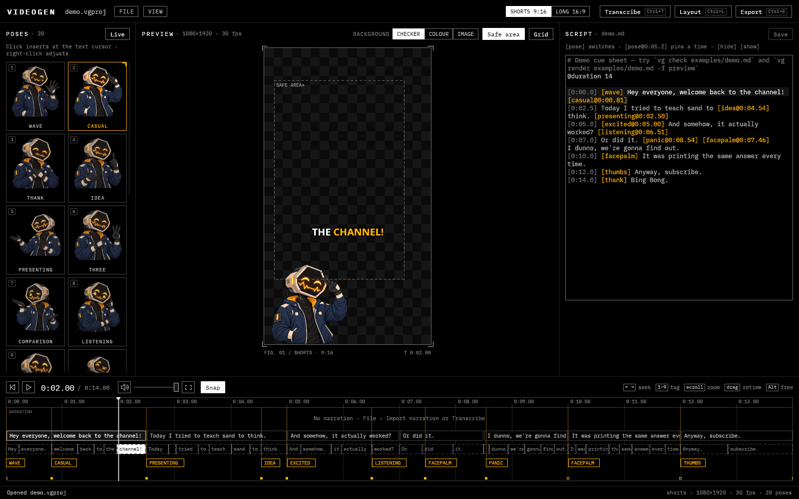
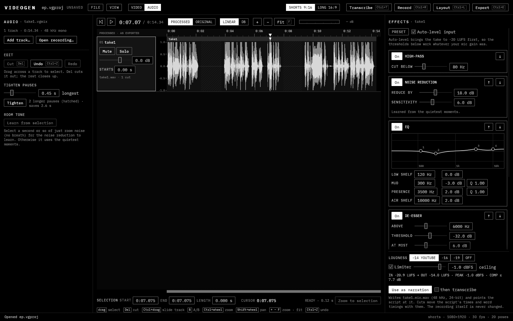

# videogen

Pose-avatar and caption overlays for self-narrated videos, in the style of
CodeBullet / Dani / Fireship Shorts. You record the narration. videogen then:

- transcribes it locally (Whisper on the GPU)
- suggests which pose your character should strike on each line
- lets you tweak everything in a GUI
- renders a **transparent avatar track** plus **word-by-word captions** that
  you drop on top of your footage in Kdenlive (or any editor)

Written in Rust with wgpu (GPU compositing) and egui (the GUI). Everything the
GUI does is also available from the `vg` command line, for scripting.



---

## Contents

- [Quick start](#quick-start)
- [The workflow](#the-workflow)
- [The GUI](#the-gui)
- [Audio: cleaning up the narration](#audio-cleaning-up-the-narration)
- [Cue sheets (the script format)](#cue-sheets-the-script-format)
- [Pose library](#pose-library)
- [LLM pose suggestions](#llm-pose-suggestions)
- [Settings: preferences, projects, transcripts, storage](#settings-preferences-projects-transcripts-storage)
- [Presets: layout, motion, captions](#presets-layout-motion-captions)
- [Exporting](#exporting)
- [Command line](#command-line)
- [Files a project uses](#files-a-project-uses)
- [How it works](#how-it-works)
- [Development](#development)
- [Troubleshooting](#troubleshooting)
- [Roadmap](#roadmap)

---

## Quick start

Requirements:

- Rust (stable)
- `ffmpeg`/`ffprobe` on `PATH`, built with libass for burned-in captions
- a Vulkan-capable GPU
- [`uv`](https://docs.astral.sh/uv/), for transcription only

```sh
cargo build --release

# 1. Build a pose library from a folder of transparent PNGs (done once per character).
./target/release/vg poses init character-art          # writes avatar/poses.ron

# 2. Open the GUI.
./target/release/vg                                     # or: vg examples/demo.vgproj
```

The repository holds only the code, its docs and the Whisper sidecar. Your
character art, pose library, scripts, recordings, transcripts, edits, projects
and exports stay in the working folder and are ignored by git (`.gitignore`
lists only what is tracked), so `character-art/`, `avatar/` and `examples/`
above are local folders, not part of a clone.

In the GUI:

1. Click **Record** (Ctrl+R) and narrate, or choose **File > Import
   narration**. A take can go straight to **Transcribe**, which turns it into
   a timed script with poses already suggested.
2. Adjust the tags. Press **Space** to play.
3. Choose **Export**.

The first transcription downloads the Whisper model (about 1.6 GB for
`large-v3-turbo`) into `~/.cache/huggingface`. After that, a minute of speech
takes a few seconds on an RTX 3090.

## The workflow

```
record narration.wav ──► Audio tab (cuts, clean-up) ──► narration.mix.wav
                                            │
                          Transcribe ──► narration.mix.md (timed lines + [pose] tags)
                                            │   edit in the GUI: click poses, drag markers
                                            ▼
                                        Export ──► avatar.mov  (ProRes 4444, transparent)
                                                   avatar.ass  (word-by-word captions)
                                                   preview.mp4 (optional: quick review with audio)
                                            ▼
                  Kdenlive: footage on V1, avatar.mov on V2, import avatar.ass as subtitles
```

The pose track is data: a plain-text cue sheet. Anything you can do by clicking,
you can also do by typing, by script, or with an LLM.

## The GUI

| Area | What it does |
|---|---|
| **Left sidebar** | Two tabs, **Poses** and **Media**, each with its count; the one you last used comes back next time. |
| **Poses** tab (left) | Thumbnails of every pose. **Click** one to insert its tag at the text cursor (in the Lines view, into the line you were last editing). Keys **1–9** do the same for the first nine. **Right-click** a pose to open its inspector under the thumbnails, where you set scale, offset, anchor, aliases, what it looks like and when it fits, then save the library. Drag the divider above the inspector to resize it; it scrolls on its own. **Copy list** copies every pose as JSON (tag, the name to write, aliases, description, good for, number key, image), for an LLM chat or notes; `vg poses list --json` prints the same. The pose showing at the playhead is highlighted. |
| **Media** tab (left) | The images, video and audio imported into the project, as **thumbnail cards** in three sections (**Images**, **Video**, **Audio**), each with its count and its own **Import** button. The cards reflow to the sidebar's width. A card shows the picture, a frame of the video (with a play mark and its length), or the audio's waveform (with its length), then the file name and size. **On timeline** marks a file used by a clip on the video track or an Audio track. The current narration and preview background are marked amber, and a file that has gone missing is crossed out in red. **Drop files** on the window to add them too (they go into the right section, and the tab opens). Files stay where they are: the project (`media` in the `.vgproj`) keeps a list of paths, relative to the project, and **Ctrl+S** saves it. Imported narration (File › Import narration) is added as well. **Click** a card to open its info panel at the bottom of the sidebar (click it again, press **Esc** over the sidebar, or click **×** to close it). The panel lists the folder, file size, when it was modified, the length, and the picture (size, frame rate, codec, rotation) and sound (codec, channels, sample rate, or "no sound"), and says where the file is used. **Add to timeline** puts it at the playhead: video and images on the video track, and audio as an Audio track under the narration. **Double-click** a card to do the same, or **drag** it onto the timeline to drop it at that time. Images: **Use as background** makes it the preview's background. Audio: **Use as narration** points the script's `@audio` at it (and `@words` at its saved transcript), and **Edit** opens it in the Audio tab. **Copy path** copies the full path (for Kdenlive), and **Remove from project** takes it out of the list and leaves the file. A missing file's panel offers only Remove. |
| **Live** button | In live mode, clicking a pose (or pressing 1–9) adds `[pose@time]` to the line being spoken at the playhead. Play your narration and tag it as you listen. |
| **Preview** (centre) | The exact frame the exporter will render, over a checkerboard, a solid colour, or a background image (drop in a screenshot of your footage). Where the **video track** has a clip at the playhead, its frame fills the canvas instead, like a background: scaled to cover it, centred, the overflow cropped (a landscape clip in a Short shows its middle). Its fades go to black, and still images show the same way (transparent parts black). The background you choose shows between clips (the control then reads **Background · between video clips**), and the line under the canvas names the clip and its source time. Frames are decoded by ffmpeg in the background at the canvas's size on screen: when you scrub or step, the frame at the playhead is fetched (the nearest one already fetched shows meanwhile, and the last few dozen are kept); when you play, each clip is streamed from the playhead (decoded on the GPU when there is one) and the next clip starts decoding just before its cut, so playback runs at the project's frame rate. A clip whose file is gone shows **MISSING VIDEO** in red, with its path. Each pose has its own spot: **drag** moves the pose on screen and **scroll** resizes it, without touching the others (a label at the top says which pose you're placing). Poses you haven't placed use the default spot. **Shift+drag** and **Shift+scroll** move or resize every pose together, keeping their spacing. Spots are saved in the project, per format. The **caption** is its own box: hover it and a dashed outline with handles appears (with its position, size and wrap width). **Drag the caption** to move it, **drag a side handle** to set the wrap width (it stays centred), and **drag a corner** or **scroll over it** to change the text size. **Double-click** it to centre it horizontally. When nothing is being said at the playhead, the nearest caption is shown faintly while you edit so there's something to place. A hint line under the canvas says what a drag will do. **Grid** shows a 6, 12 or 24 cell grid and pulls the avatar's anchor (the bottom-centre of the body), the caption's centre and a dragged wrap edge onto the nearest grid line within 10 px while you drag, lighting that line up. The grid includes the edges, centre and thirds. Hold **Alt** to place freely. **Safe area** outlines, with a dashed line, the part of a Short that YouTube's player UI leaves clear (an estimate). Captions are drawn live with the same font the export uses (found with fontconfig), sized, wrapped and placed the way libass renders them. |
| **Script** (right) | **Lines** (the default) lists the spoken lines. On the left of each line is its time: white when it's pinned in the script, and muted with a `~` when it's estimated from its neighbours. Its length is shown under it. **Click a time** to play from it, **drag it** (or double-click and type) to retime the line, and **right-click** it to play from it, pin or unpin the time, add a line below or delete the line. The words are edited in place, with pose tags lit amber and `[hide]`/`[show]` white. **Enter** splits a line, and **Add line** adds one at the playhead. The line being spoken is white with a bar at its left. Comments and `@` directives aren't shown. Instead a **details** footer shows the narration (**Change**), word timings (**Change**, **Clear**), the start pose (a dropdown for `@start`), the length (set on the timeline, with **Fit to narration**), and how many comment lines are hidden. **Source** shows the whole cue sheet as text, with highlighting, for anything else. Errors are listed at the top; click one to go to its line. The script re-parses as you type. |
| **Length** (above the timeline) | How long the video is. Type a time (`1:05.5` or `65.5`), drag the value, or drag the **END** tab at the top of the timeline. Everything after the end is shaded, and the view reaches a little past it so you can drag it out. The end snaps to the narration's end, words, lines and pose changes. It's stored as `@duration`. **Fit to narration** (or double-clicking END) removes it, so the video ends with the narration again. |
| **Audio state** (next to Length) | How the timeline's sound relates to the Audio tab. It's quiet when they match. **Playing the raw take · Use the edited audio** means the script still plays the recording, not your edit; the button renders the edit and makes it the narration. **New cuts in the Audio tab · Apply to script** means cuts moved the timing; the button rewrites the narration and moves the script's times with it. Edits that only change the sound (effects, gain, mutes, music) update the narration by themselves: when you switch back to the Video tab, when you save, or once a pending render finishes. |
| **Timeline** (bottom) | Five labelled sections, top to bottom, named in a gutter on the left with a small glyph each (just the glyphs when the panel is narrow): **Audio** (the narration's waveform, plus every Audio-tab track as clips on the same timeline: voice outlined, music filled, named), **Transcript** (script lines), **Captions** (caption words), **Video** (the project's video track) and **Poses** (flags). The sections alternate backgrounds; the one your keys act on (Audio or Video: the last one you clicked, or click its name) is lit in the gutter, and the transport row shows its actions. The **Captions** section shows every caption word as a block that starts when its highlight starts. The word being highlighted is lit white. **Drag a word's left edge** to change when its highlight starts, or **drag the word** to move it. Words can't cross their neighbours. Solid blocks are timed from the transcript. Dashed blocks are estimated (no transcript, or the line was edited), and dragging one pins that line's timings. Edited timings are saved to the script's `@words` file when you save; if there isn't one yet, `<script>.words.json` is created and `@words` is added to the script. **Snap** (**Off / Captions / Video**, Captions by default) pulls drags toward targets and draws a dashed guide at the snap point: **Captions** snaps to word transitions, line cuts (line starts and ends), other pose changes and the playhead; **Video** snaps to video clip edges and the playhead. Moving and trimming a video clip also snaps to the other clips' edges. Hold **Alt** to drag freely. Flags that would overlap drop to a second row. **Cutting the narration** happens in the Audio section: **drag** across it to select a stretch, **click a clip** to select it, or **drag a clip's edge** to trim it (a red band over the audio, script and words shows what goes). **Delete** (or the red **Delete** button) removes the selection, **Keep only** removes everything else, and **S** (**Split**) cuts the clip at the playhead without removing anything; cuts are marked with notches. Everything after a cut moves up: the script's times, the word timings and the pose tags follow the audio (video clips stay where they are). The cut is made in the narration's Audio-tab edit (the recording is never changed) and written to `<recording>.mix.wav`, which becomes the narration. **Editing video** happens in the Video section (see *Video track* below). **Ctrl+Z** (**Undo**) undoes the latest edit, whether a narration cut (the audio, script and words go back) or a video edit; **Ctrl+Shift+Z** or **Ctrl+Y** (**Redo**) redoes a video edit (narration cuts have no redo). **Esc** drops the selections. Drag the panel's top edge to resize it: every section grows or shrinks with it (the waveform the most), and it stays at the height you leave it. Click to seek. **Drag a flag** to retime its tag: the script gets an explicit `@time`, and the flag's square foot fills in. **Right-click a flag** to delete its tag. **Scroll** zooms and **Shift+scroll** pans; the view reaches past the end of the narration or the video track, whichever is later. A hollow foot means the tag is placed by its position in the text. |
| **Header** | The project name, File and View menus, the **Shorts 9:16 / Long 16:9** toggle, and the main actions with their keys. |
| **Status line** | Messages (`Error · …` with a dashed edge; click it to dismiss), or the line, tag and narration counts. The preset is summarised on the right. |
| **Floating windows** | Layout, Suggest, Record, Transcribe and Export each open in their own spot: Layout top-left, Suggest top-centre, Record top-right, Transcribe bottom-right, Export bottom-left. A window that would cover another open one moves to the nearest free space; they only overlap when the screen is full. A window you drag keeps its spot until you quit. |
| **Layout** window | The preset: canvas size and fps, avatar placement, motion (pop, bob, breathing) and captions. The placement sliders set the default spot; poses placed on their own are listed with their position and size, each with **Reset** (back to the default), plus **Reset all**. The pose inspector shows the selected pose's **Canvas spot**, with **Use default**. The inspector's red **Delete** button removes the pose after a confirmation: it says how often the open script uses the pose, saves the library straight away, and can also move the pose's image to the trash (off by default). |
| **Record** | Records narration from a microphone. Pick the **input** (the system default follows your PipeWire/Pulse default, so choosing the mic there works too), an optional **3 s countdown**, and whether to **transcribe** the take when you stop. While recording you get a peak meter (−60 to 0 dBFS, with a held peak; aim for peaks around −12 to −6, and a dashed **CLIP** box appears if anything hits 0), the last 8 s of waveform and the elapsed time, and the header shows `REC m:ss`. Takes are saved next to the script as `<script>-take<N>.wav` (32-bit float mono at the device's rate), and the header is refreshed every second, so a crash keeps what was recorded. **Stop** makes the take the narration (`@audio`), or starts transcribing it into a new script if that's ticked. **Discard** (or stopping during the countdown) deletes the take. Closing the window keeps the take. Playback stops while recording so the speakers aren't picked up. Earlier takes are listed with **Use** and **Transcribe**. |
| **Transcribe** | Makes a timed, pose-tagged script from the narration. A recording that already has a saved transcript (`<recording>.words.json`) is never transcribed again on its own: the window shows it and offers **Use saved transcript** (reads it from disk, no Whisper) and **Transcribe again** (runs Whisper and replaces it). Recordings without one get **Transcribe**. Importing narration, or using a take, points `@words` at its saved transcript when there is one. If the current script has unsaved edits, it asks first. |
| **Export** | Pick a format and output path, then **Render**. A progress bar and Cancel are shown while it runs. **Preview MP4** includes the video track under the avatar; with clips on it, the transparent formats say that they leave it out (they're the overlay alone, for putting above your footage). |

**Video track.** The Video section holds the project's video clips and still images (saved in the `.vgproj` as `video: [...]`). Add them by dragging a card from the Media tab onto the timeline: a dashed ghost shows where the clip will land (the first gap at or after the pointer that it fits in, with an arrow when that's further along); audio dropped there goes to the Audio section instead. Each clip shows a filmstrip of its thumbnail, its name, fade ramps, a crossed-out speaker when muted and **STILL** on images; a missing file is red. **Click** a clip to select it (white edge) and seek, **drag** it to move it (it stops at its neighbours), **drag an edge** to trim it (a dashed outline shows where it was, and a tag its new length), and **drag the ▼ handles** at its top corners to set its fades. **Drag across a gap**, or **Shift+drag** anywhere, to select a stretch of the track. With the Video section focused, **S** splits the clip under the playhead, **Delete** lifts the selected clip or stretch (leaving a gap), **Shift+Delete** ripple-deletes (closing the gap), and **M** mutes or unmutes the clip's own sound. The transport row has the same actions, plus the fade lengths as small fields, and **right-clicking** a clip opens a menu (Split at playhead, Delete, Ripple delete, Mute, Remove fades, Show in the Media tab).

Shortcuts:

| Key | Action |
|---|---|
| Space | Play / pause |
| Home | Jump to the start |
| ← / → | Seek back / forward 1 s |
| J / K / L | Back 5 s / pause / play |
| ↑ / ↓ | Previous / next edit point (pose change or line start) |
| , / . | One frame back / forward |
| End | Jump to the end |
| 1–9 | Tag with one of the first nine poses |
| Alt (while dragging) | Ignore snap and grid |
| Ctrl+S | Save the project |
| Ctrl+R | Record window; with it open, start / stop a take |
| Ctrl+T | Transcribe window |
| Ctrl+G | Pose suggestions (LLM) |
| Ctrl+1 / Ctrl+2 | Video / Audio tab |
| S | Timeline: split the narration or the video clip at the playhead (whichever section is lit) |
| Del / Shift+Del | Timeline: delete the selection or clip; in the Video section Shift+Del also closes the gap |
| M | Timeline: mute or unmute the selected video clip's sound |
| Ctrl+Z / Ctrl+Shift+Z, Ctrl+Y | Timeline: undo the latest cut or video edit / redo a video edit |
| Esc | Timeline: drop the selections |
| Del, M, Ctrl+Z, B | Audio tab: cut, mute the selection, undo, A/B |
| + − F, Ctrl+wheel | Audio tab: zoom in, zoom out, fit (to the selection if any), zoom at the pointer |
| Ctrl+L | Layout window |
| Ctrl+E | Export window |
| Ctrl+, | Settings |

The playback keys only work while the script editor doesn't have focus.

**Hot reload.** videogen watches the pose PNGs and `poses.ron` and reloads them
when they change, so you can redraw a pose in Aseprite or Krita and see it
immediately. An edited script on disk is reloaded too, unless you have unsaved
edits in the GUI.

**Remembered settings.** The last project, preview background, volume and
everything under **Settings** (Ctrl+,) are restored on launch.

## Audio: cleaning up the narration

The **Audio** tab (header **Video | Audio**, or Ctrl+1 / Ctrl+2) turns a raw
mic take into clean, even, loud-enough narration: cuts, a voice effect chain,
extra tracks, and mastering to YouTube loudness. It edits the script's
narration (`@audio`).



- **Where edits live:** a `.vgmix` file next to the recording (for example
  `take1.vgmix`). The recording itself is never changed.
- **Output:** **Use as narration** writes `take1.mix.wav` (48 kHz, 24-bit
  mono) and points the script at it.

| Area | What it does |
|---|---|
| **Audio** (left) | **Record new track** records from the mic straight into a new track at the playhead (a pickup line or a retake) with the same clean-up chain as the narration; the Record window says so and its button reads **Stop and add track**. With no edit open it reads **Record narration**. **Open recording** opens a browser of earlier recordings in the project's folders, newest first, each with its length, transcript and the scripts that use it. Per row: **Edit** (open it in this tab; it stays open until the script's narration changes), **Add as track** (as voice, at the playhead), **Use as narration** (points the script's `@audio` at it, and `@words` at its transcript), and **Open script** or **Transcribe**. **Browse for a file** opens any file; **Add music or effects** adds a plain track a bit under the voice. |
| **Background music** (left) | **From a file**, or paste a **YouTube link** (or any site `yt-dlp` supports) and **Download**: the audio is saved to `music/` next to the script and added as a music track. Music starts at 0:00 on the project timeline, loops to the end of the narration (plus 1.5 s), fades in and out, and **ducks** (dips) while you talk, starting just before each phrase. Select a music track to set its volume, how far it ducks, the fades, and loop or play once in the right-hand panel. It's a track like any other: cut it, mute parts, fade or turn parts up or down, or give it effects. Use music you have the rights to. |
| **Selection** (left) | Drag across any track to select part of it (the range is shown in the section heading). **Cut** removes it and closes the gap. **Mute** (M) silences it and keeps the timing. **Keep only this** cuts everything else on that track. The slider and **Set gain** make it louder or quieter (−24 to +12 dB). **Fade in** / **Fade out** ramp it from or to silence. **Reset** removes the adjustments in the selection. **Learn room tone** teaches the noise reduction from it, and **Zoom to it** (F) fills the view. Gain, mute and fades apply after the effects, so the compressor doesn't undo them, and short ramps at their edges avoid clicks. They're anchored to the recording, so they stay on the same words when you cut earlier audio. On the waveform, muted stretches are darkened, gain changes are labelled and fades are drawn as ramps. |
| **Adjustments** (left) | The selected track's mutes, gain changes and fades, in time order. Click one to select its range; × removes it. |
| **Edit** (left) | **Cut** (Del) removes the selection and closes the gap, with an 8 ms crossfade so there's no click. **Undo/Redo** (Ctrl+Z / Ctrl+Shift+Z) cover every change; a slider drag is one step. **Tighten pauses** shortens every pause longer than the slider (0.45 s by default) down to that length, keeping equal room on both sides. The pauses it would shorten are hatched on the track, and it tells you how much time it saves. **Room tone · Learn from selection** teaches the noise reduction from a stretch of pure room noise. If the selection crosses a cut, the longest uncut part is used. |
| **Editor** (centre) | Laid out like Audacity: a ruler above the tracks, and tracks of a fixed height stacked from the top (drag a track's bottom edge to resize it; scroll when there are many). Each track has a **control panel** on the left (name, **Mute**, **Solo**, gain, where it starts, and **×** to remove extra tracks), an amplitude scale, and its clip, with a header bar holding the clip's name. The waveform shows min/max peaks with the RMS level in a lighter shade, around a zero line. **Processed** shows each track as it will be exported (at its final level). **Original** shows the take as recorded, with any clipping marked at the lane edges. **Linear / dB** switches the amplitude scale; dB makes the noise floor visible. Cuts are dashed split lines with a marker in the clip header. **Drag** across a track to select (the view follows past the edges), **click** to seek, **Ctrl+drag** to slide a track in time. The wheel works as in Audacity: it scrolls the tracks, **Shift+wheel** pans, and **Ctrl+wheel** zooms at the pointer. A scrollbar sits under the tracks. |
| **Transport** | Play (Space), Home, ← →. **Processed / Original** (B) is an A/B switch. The original has the same cuts and is matched to the same loudness, so you compare the sound, not the volume. **+ / −** zoom around the playhead. **Fit** (F) shows everything, or the selection if there is one. A playback meter shows the RMS as a bar and the peak as a tick. |
| **Selection bar** (bottom) | **Start**, **End** and **Length** of the selection. You can edit them: drag, or type `1:02.5`. It also shows the cursor time, the render status (`RENDERING…` or `READY · 0.2 s`), and **Zoom to selection**. |
| **Effects** (right) | The selected track's chain, top to bottom. Each effect has **On/Off** and **↑ ↓** to reorder. **Preset** replaces the chain: *Condenser voice (AT2020)*, *Gentle*, *Punchy*, *All off*. **Auto-level input** brings the take to −20 LUFS first, so the thresholds mean the same thing whatever your mic gain was. |
| **Master** (right) | **Loudness** target: −14 LUFS (YouTube), −16, −19 or off. **Limiter** with a ceiling (−1 dBFS). A readout shows the loudness in and out, the peak and the most compression. **Use as narration** writes the mix and points the script at it. With **then transcribe**, a script is made from the result's transcript (the word timings carried over from the edit; Whisper only runs if there are none). |

Every change re-renders in the background (debounced about 0.1 s), so you hear
the result almost at once. Each effect stage is cached, so changing the
compressor only re-runs the compressor and the effects after it. A 5-minute
narration renders from scratch in about 1.5 s; tweaks take a fraction of that.

**The effects.** All are written in Rust (`crates/vg-audio`), offline, on
48 kHz mono:

| Effect | What it does | Condenser preset |
|---|---|---|
| High-pass | 24 dB/oct Butterworth: rumble, desk thumps, plosive boom | 80 Hz |
| Noise reduction | Spectral, decision-directed (Ephraim–Malah) Wiener gain on a 2048-point STFT. It learns the noise from the quietest 10 % of the take, or from a room-tone selection. It leaves a steady residue instead of "musical noise" warble. | −18 dB, sensitivity 6 dB |
| EQ | Low shelf, two peaking bands, high shelf, with an interactive curve: drag a handle for frequency and gain, scroll on bands 2–3 for width | 300 Hz −3 dB (boxiness), 3.5 kHz +2 dB (presence), 10 kHz shelf +2 dB (air) |
| De-esser | Split band: only the part above the frequency is turned down, and only while it's loud | above 6 kHz, up to 6 dB |
| Compressor | Soft-knee, feed-forward | −24 dB, 3:1, 8 ms / 120 ms |
| Gate | A downward expander, last in the chain so it catches room noise the compressor lifts. It opens a set amount above the measured noise floor, looks 10 ms ahead so words aren't clipped, and holds briefly. | 8 dB above the floor, −12 dB, 180 ms |
| Master | Loudness to the target (BS.1770 / EBU R128 integrated), then a look-ahead limiter. Gain is refined until the limited result lands on the target. | −14 LUFS, −1 dBFS |

On a test take (synthetic speech, recorded quiet at −27 LUFS with hiss, 60 Hz
hum and rumble), the condenser preset gives −14.1 LUFS with a −1.0 dB peak, as
ffmpeg's `ebur128` measures it. The noise in the pauses falls from 32 dB below
the speech to 52 dB below. Against the same audio without noise reduction, the
speech itself changes by only 30 dB SNR, which is about the noise that was
removed.

**Cuts and the script.** The script's times are in the narration's clock, so
cutting audio would put every later line in the wrong place. **Use as
narration** fixes that:
- **Line times and `@time` tags** after a cut move up by the cut's length.
  Anything that was inside a cut lands on the cut.
- **Word timings** are moved the same way into `take1.mix.words.json`. Words
  inside a cut are dropped. Edit those words out of the script text too, or
  tick **then transcribe** for a fresh script.

The `.vgmix` remembers which cuts the script was last matched to, so you can
come back, cut more, and apply again. Only the new cuts move things.

**Recording tips for a cardioid condenser (AT2020).**
- **Set the gain** so your loudest words peak around −12 to −6 dBFS. The
  Record window's meter shows this. Too hot clips (irrecoverable), too quiet
  raises the noise.
- **Distance:** 10–20 cm, with a pop filter. Angle the mic slightly off your
  mouth, so plosives pass by and sibilance is softer.
- **Room tone:** stay silent for 2–3 s at the start of every take. Select it
  and click **Learn from selection**. Noise reduction works best with a clean
  sample of the room.
- **The room:** a condenser hears it. Soft furnishings, a closet or a duvet
  behind the mic beat any plug-in.
- **Mistakes:** keep going, pause, and repeat the line. Then cut the bad take
  and **Tighten pauses**.

## Cue sheets (the script format)

A cue sheet is a plain `.md` or `.txt` file. There is one line per sentence, and
tags in square brackets:

```text
# Comments and headings start with # (or //) and are ignored.
@audio narration.wav            # narration; sets the video length
@words narration.words.json     # word timings from `vg transcribe` (optional)
@duration 1:30                  # length when there's no audio (optional)
@start wave                     # pose before the first tag (optional)

[0:00.00] [wave] Hey everyone, welcome back!
[0:02.32] Today I tried to teach a robot to walk, and [excited] it worked.
[0:06.18] [surprised] Wait. [panic@0:06.62] Oh no.
Lines without a time are spread evenly between their neighbours. [shrug@+0.5]
[0:12.00] [thumbs] Anyway, subscribe. [hide@13.4]
```

- **Line time.** A `[time]` at the very start of a line is when it's spoken.
  Times can be written as `12.5`, `1:02.5` or `1:02:03.5`.
- **Tags** switch the pose:
  - `[name]` takes effect where it sits in the line: on the next spoken word
    when `@words` is present, otherwise by its position in the text.
  - `[name@1:02.5]` sets an absolute time.
  - `[name@+0.8]` sets a time relative to the line's start.
- **Names** are a pose's tag or any of its aliases, and are case-insensitive.
  An unknown name is an error that suggests the closest match.
- **Special tags:** `[hide]` shrinks the avatar off screen and `[show]` pops it
  back. Any pose tag after a `[hide]` also brings it back.
- **Timing rules:** the same pose tagged twice in a row re-pops, which is useful
  for emphasis. Without `@start`, the avatar holds the first tagged pose until
  its tag.

## Pose library

`avatar/poses.ron` lists the character's poses. `vg poses init <art dir>` (or
**File > New pose library from art folder**) generates it from a folder of
transparent PNGs:

- **Tags** come from file names: `09_excited_discovery.png` becomes
  `excited_discovery`.
- **Aliases** are added automatically for each unambiguous word of the tag, at
  least 4 letters long: `excited`, `discovery`.
- **The anchor** is the bottom-centre of the opaque pixels, so poses line up
  when they switch.

Per pose you can set `scale` (for art drawn at a different size), `offset`
(a nudge, in avatar heights) and `anchor`. It's easiest in the GUI inspector
(right-click a pose). The art itself is never modified.

**Adding a batch of new poses.** Put the new PNGs in a folder, for example
`character-art/new-needs-processing/`, and run `vg poses import <folder>` (or
use **File > Import new poses from a folder**).
- **Numbering:** the files are numbered on from the highest number in the art
  folder, keeping the batch's own order, then moved into the art folder. For
  example, `05_reaction_caught_in_the_act.png` becomes
  `24_reaction_caught_in_the_act.png`.
- **The library:** the new poses are appended, and existing poses and your
  tweaks are left as they are.
- **Aliases for new poses:** the tag without a category prefix that several
  tags share (`reaction_wait_what` → `wait_what`), and unique words of 5 or
  more letters.
- **Safety:** nothing moves if a name would clash, and the empty folder is
  removed afterwards.

**Descriptions.** A pose can carry a `description` (what it shows, and how it
differs from similar poses) and `use_when` (the moments it suits, with example
phrases). The LLM that suggests poses reads these; see
[LLM pose suggestions](#llm-pose-suggestions). The 27 poses in
`avatar/poses.ron` have hand-written ones. Edit them in the pose inspector
(right-click a pose), and write them for new poses you import.

## LLM pose suggestions

**Suggest** in the Poses panel (Ctrl+G, or **File > Suggest poses with an
LLM**) sends the script to an LLM, which proposes pose tags. You review the
proposals before any of them go into the script.

**What is sent.** Only text goes out: the script's spoken words (with the
line numbers, and which pose is showing) and the pose library's names, aliases
and descriptions. No images, and nothing else from the project.

**Server.** One server is used at a time: the one selected in the window's
**Server** list. By default the list starts with `http://localhost:8080/v1`,
and can be customised in `videogen.ron` or `~/.config/videogen/config.ron`
(see [`videogen.example.ron`](videogen.example.ron), or set `$VG_LLM` /
`$VG_CONFIG`). Any OpenAI-compatible server (llama.cpp, vLLM, Ollama, etc.)
works; type its URL and **Add**, or **Remove** one. **Test all** shows each
server's models, or its error.

**Using it.**
1. Select the server.
2. **Lines:** *Untagged only* fills gaps and keeps your tags. *All* suggests
   for every line, and applying replaces the pose tags (`[hide]`/`[show]`
   stay).
3. **Direction** is optional, for example "more reactions, fewer waves".
4. **Suggest poses** returns a list: tick box, pose, the line with a `›` where
   the pose switches (on a specific word, so a pose can change mid-sentence),
   and a short reason. Click a line to jump the preview to it.
5. **Apply** writes the ticked ones into the script. **Undo apply** takes them
   back, and Ctrl+S saves.

In the Transcribe window, **suggest pose tags: Rules | LLM** picks between the
built-in keyword rules and asking the LLM straight after transcribing.

**Keeping the answers usable.** Small models get formatting wrong, so each step
has a fallback:
- **The schema.** Each request carries a JSON schema. The pose field is an
  enum of your tags. Every line to tag is its own schema branch, with its line
  number fixed and `at_word` limited to that line's actual words. Servers that
  enforce schemas (llama.cpp's grammars, vLLM's guided decoding) can't produce
  a wrong pose, line or word.
- **If a server rejects the schema,** the client drops to JSON mode, then to
  plain prompting, and remembers what worked.
- **Reasoning models** are asked not to think (`enable_thinking: false`). If
  one still runs out of tokens before answering, it's retried with a bigger
  budget.
- **Parsing is lenient.** It strips `<think>` blocks and code fences, finds
  the JSON inside prose, and fixes trailing commas, smart quotes, and
  `True`/`None`. An answer cut off mid-way is closed at its last complete
  entry.
- **Broken JSON** goes back to the model with the parse error, up to twice.
- **Every suggestion is checked.** Pose names are matched loosely (`Face Palm`
  → `facepalm`, typos by closeness). Words are found exactly, then by prefix,
  then by closeness. Lines outside the batch, lines that are already tagged
  (in *Untagged only*) and poses that are already showing are dropped.
- **Nothing is hidden.** Everything fixed or dropped is listed under **Fixes
  and drops**.

Long scripts go in batches of 20 lines. Each batch sees the last few lines
before it and the pose showing, so choices carry over.

In a test on a 14-line script:

| Model | Time | Result |
|---|---|---|
| `lfm2.5-2.6b` (llama.cpp) | 80–90 s | Sensible picks. The model reasons at length. |
| `qwen3.8-flash-next` (vLLM) | 11 s | Picks of the same quality. |

The same from the command line:

```sh
vg suggest script.md                 # print suggestions (and what was fixed or dropped)
vg suggest script.md --apply         # write them into the script
vg suggest project.vgproj --replace --style "fewer waves" --llm http://localhost:8080/v1
```

## Settings: preferences, projects, transcripts, storage

**Settings** in the header (or Ctrl+,) opens one window with four pages. The
Settings menu also opens each page directly, and **File > Recent projects**
lists recent projects, with **Manage projects** at the bottom.

**General.** Your defaults:
- **Recording:** input, countdown, and transcribing after a take.
- **Transcription:** Whisper model, language, and how new scripts get pose tags
  (none, rules or the LLM). The Transcribe window uses and changes the same
  settings.
- **Pose suggestions:** which server is selected.
- **Playback:** volume.
- **Editing:** snapping, the canvas grid and the Shorts safe area.

**Reset preferences** puts this page back to its defaults, keeping recent
projects, folders, kept transcripts, the transcript limit and your LLM servers.

**Projects.**
- **The list:** your recent projects plus every `.vgproj` up to two folders
  deep in the projects folder (the working directory, unless you **Change folder**
  it). The open project is marked.
- **Create and open:** makes `<folder>/<name>/<name>.vgproj` with a starter
  script, using the current pose library and preset.
- **Row buttons:**
  - **Open:** asks first if you have unsaved changes.
  - **Rename:** renames the script to match, if you tick that.
  - **Duplicate:** copies the project and its script. The narration and
    transcripts are shared.
  - **Forget:** removes a project from the recent list.
  - **Delete:** moves the project and its script to the system trash. You tick
    exactly which files go; recordings are never included.

**Transcripts.**
- **What they are:** the `<recording>.words.json` files Transcribe writes, found
  in the project's folder, the script's folder and the working directory, plus
  any folders you **Add**.
- **The list:** words, length, language, whether the recording is still next
  to it, which scripts use it (`@words`), size and age. **Transcribe audio**
  makes a new one.
- **Edit selected:** click a name.
  - **Rename:** the scripts that point at the transcript are updated.
  - **Transcribe again:** runs Whisper on the recording and replaces the
    transcript. This, and the Transcribe window's button of the same name, are
    the only ways a saved transcript is regenerated.
  - **New script from it:** a fresh cue sheet from the transcript, without
    running Whisper.
  - **Words:** fix or retime each word, or delete one, then **Save**.
  - **Open a script:** click one of the scripts that use it.
- **Bulk edit:** tick transcripts (or **All**) and apply one of these.
  - **Find and replace:** for example `code bullet` → `CodeBullet`. Phrases can
    match across words, the new words share the old ones' time, and you can
    choose whole words or match case.
  - **Remove filler words:** the list is editable, and a sentence's full stop
    is kept.
  - **Shift times:** by ± seconds.
  - **Set the language.**

  With **also change the scripts that use them** ticked (the default), the
  same edit goes into those scripts' spoken text. Tags, times, directives and
  comments are left alone, so each script line still matches its transcript
  word for word and the captions stay timed. Counts are shown before you
  apply, and **Undo** restores every file the last edit changed. If the open
  script has unsaved edits, it asks you to save first.
- **Delete:** moves the ticked transcripts to the trash, and warns which
  scripts still use them. Their recordings are listed unticked.

**Storage limit** (on the Transcripts page) keeps transcripts under a size you
set:
- **Counting recordings:** tick this to count each transcript's recording as
  well, and remove it with the transcript.
- **What goes:** when the total goes over, the oldest are moved to the trash.
  The check runs at start-up, after each transcription and after saving.
- **What is never removed:**
  - transcripts marked **kept** (the toggle next to each name)
  - the open script's transcript
  - by default, any transcript a script uses
  - the narration that's playing
- **Before it runs:** the page shows the usage and exactly which transcripts
  would go, and **Clean up now** applies it.

The limit is off until you turn it on (the default is 500 MB).

**Storage & cache.**
- **Clear caches:** frees the Audio tab's render cache (decoded audio and each
  effect's output, in memory) and reloads the pose images, narration and word
  timings from disk. Nothing you made is touched.
- **Downloads on disk:** each Whisper model (1.6–3 GB, in the Hugging Face
  cache) and the transcriber's Python environment (`sidecar/whisper/.venv`),
  with their real size. **Delete** removes one for good; it downloads again
  the next time it's needed. Deleting a model also frees the files that
  only it uses in Hugging Face's shared `blobs` folder.

The same transcript edits from the command line (`--dry-run` shows the counts
without writing, and `--no-scripts` leaves scripts alone):

```sh
vg transcripts list [folders…]
vg transcripts replace "code bullet" CodeBullet .     # every transcript in . and its scripts
vg transcripts fillers narration-take3.words.json --words "um, uh, like"
vg transcripts shift -0.25 narration-take3.words.json
```

## Presets: layout, motion, captions

A preset is saved inside the project, and **Save preset** / **Load preset**
store it as `.ron`. There are two built-in presets:

| Preset | Canvas | Avatar | Captions |
|---|---|---|---|
| `shorts` | 1080×1920, 30 fps | lower left, 28% of height | 3 words at a time, UPPERCASE, centred at 62% height |
| `long` | 1920×1080, 30 fps | lower right, 46% of height | subtitle style, up to 7 words, at 88% height |

The settings:

- **Avatar layout:** the anchor position (as a fraction of the canvas), the size
  (pose image height as a fraction of the canvas height), and mirroring.
- **Motion:**
  - *pop*: a squash-and-stretch spring on every pose switch, with depth,
    bounciness and settle
  - idle *bob* and *breathing*, with their period
  - *hide time*
- **Captions:**
  - font, size, position (horizontal and vertical centre), wrap width, words at once
  - text and spoken-word colours
  - outline, pop-in, uppercase

## Exporting

| Format | Use it for |
|---|---|
| **ProRes 4444 (.mov)** | The default. Transparent, and imports cleanly into Kdenlive, Resolve and Premiere. Large, around 10 MB per second at 1080×1920. |
| **VP9 (.webm)** | Transparent and small, but slower to encode. |
| **PNG sequence** | Transparent frames in a folder. |
| **Preview MP4** | The avatar over the video track (a solid colour between clips), with the narration, the clips' own sound and **captions burned in**, for reviewing on your phone. Uses NVENC when available. |

**The video track in the preview MP4.** Each clip is laid under the avatar
the way the GUI preview shows it: scaled to cover the canvas and cropped
evenly, with its fades to black, frame-accurate to the clip's in-point. Its
sound is mixed in at its own level with the narration, faded with the
picture, unless the clip is muted. ffmpeg does this in one filter graph
(per clip: trim, cover-fit, fade, shift to its start, then overlay; the
sounds are delayed and summed), decoding the clips on the GPU when it can.
A missing clip stops the export with its name and time. ProRes, VP9 and PNG
exports never include the video track: they stay transparent overlays.
`vg render project.vgproj -f preview` gives the same result as the GUI.

When captions are enabled, `<output>.ass` is written next to the video. In
Kdenlive, import it with *Project > Subtitles > Import Subtitle File*, or burn
it in on export. Output paths are relative to the project file.

Rendering happens on the GPU. It runs at about 3× realtime at 1080×1920 on an
RTX 3090, and ffmpeg's encoder is usually the bottleneck. Video clips in a preview MP4 add
ffmpeg's decoding and compositing (a 21 s Short with four clips took about
40% longer than without).

## Command line

```text
vg [PROJECT]                         open the GUI (optionally with a .vgproj)
vg poses init <art dir> [-o avatar/poses.ron] [--force]
vg poses list [--poses avatar/poses.ron]
vg poses import <folder> [--poses …]          add a batch of new pose PNGs
vg suggest <cues.md | project.vgproj> [--llm URL] [--replace] [--style TEXT] [--apply] [-o out.md]
vg record [out.wav] [--device NAME] [--seconds N] [--list]
vg transcripts list|replace|fillers|shift …     list or bulk-edit transcripts and their scripts
vg mix <audio | edit.vgmix> [-o out.wav] [--preset condenser|gentle|punchy|off] [--tighten SECS] [--lufs -14] [--off gate,eq,…]
vg transcribe <audio> [-o cues.md] [--model large-v3-turbo] [--language en] [--no-tags] [--force]
vg check  <cues.md | project.vgproj> [--poses …] [--preset shorts|long|file.ron] [--duration secs]
vg render <cues.md | project.vgproj> [-f prores|webm|png|preview] [-o path] [--poses …] [--preset …]
```

- **Defaults:** for a bare cue sheet, `render` and `check` use
  `avatar/poses.ron` and the `shorts` preset. For a `.vgproj`, they use the
  project's settings.
- **`record`** records from the default input (or `--device`, see `--list`)
  until you press Enter, showing a level meter, and writes the next free
  `narration-take<N>.wav` unless you name a file.
- **`mix`** runs the Audio tab's chain without the GUI. It takes a raw
  recording with a preset, or a `.vgmix` edit, and prints the loudness in and
  out. `--tighten 0.4` shortens pauses. `--off` turns effects off, for
  comparisons. `VG_DEBUG=1` prints how long each stage takes.
- **`transcribe`** writes `<audio>.words.json` and `<audio>.md` next to the
  audio.
- **`check`** prints the resolved timeline. Use it to sanity-check a script
  written by hand or generated by a tool.

A complete scripted run:

```sh
vg record take3.wav              # Enter stops
vg transcribe take3.wav
vg render take3.md -f preview    # take3.md → out/preview.mp4 (+ out/preview.ass)
vg render take3.md               # out/avatar.mov (+ out/avatar.ass)
```

## Files a project uses

```
my-video/
  video.vgproj          # RON: paths to the pose library and script, the preset, export settings
  narration.wav         # your recording (never modified)
  narration.vgmix       # the Audio tab's edit: cuts, tracks, effects (RON)
  narration.mix.wav     # the cleaned-up narration it renders
  narration.words.json  # word timings (from Transcribe)
  narration.md          # the cue sheet
  out/avatar.mov        # exports
  out/avatar.ass
```

All paths inside `.vgproj` are relative to it, so a project folder can be moved
as a whole. The pose library usually lives outside it, shared by all your
videos, for example `../avatar/poses.ron`.

## Look and feel

The UI follows the Botslop design system:

- **Colour:** a true-black field with thin white structure. Supporting text is
  grey.
- **Type:** IBM Plex Sans for reading and controls. IBM Plex Mono, the design
  system's face, is kept for timecodes, numbers, file paths, key chips, pose
  tags and the script source. Both are bundled in `crates/vg-app/assets/fonts`
  under the SIL Open Font License. Captions are uppercase and tracked.
- **Scrollbars:** thin (6px) on the black field. The handle is rule grey,
  brighter under the pointer, and white while dragged.
- **Edges:** square, 1px.
- **Keys:** shown as chips next to the actions they trigger.
- **One accent:** phosphor amber `#ffb000`, the character's own glow. It marks
  poses and nothing else: tags, flags, and the pose showing right now.
- **Stillness:** the interface only moves when you do something. The avatar's
  motion belongs to the video.

`crates/vg-app/src/gui/theme.rs` holds the palette and the shared controls:
tool buttons, segmented toggles, key chips and line icons.

## How it works

```
crates/
  vg-core     data model, no GPU: pose library, cue-sheet parser, timeline resolution,
              motion curves (t → pose, scale, offset), autotag rules, captions (.ass),
              path helpers shared by the other crates
  vg-render   wgpu compositor: pose sprites drawn with premultiplied alpha into an
              offscreen canvas; an un-premultiply pass + read-back for export
  vg-media    ffmpeg/ffprobe subprocesses: alpha encoders, the preview MP4 (with the
              video track composited under the avatar), media probing, mono audio
              decoding and waveform peaks, single frames and streamed video frames
              (CUDA-decoded when available)
  vg-audio    narration clean-up: biquads, spectral noise reduction, gate, de-esser,
              compressor, BS.1770 loudness, look-ahead limiter; the .vgmix edit model
              (clips, cuts, time mapping); a cached, parallel renderer
  vg-llm      OpenAI-compatible client, schema-constrained pose suggestions with lenient
              parsing, repair and validation
  vg-project  .vgproj files and the video track's edit model, export jobs, projects
              and transcripts on disk, running the Whisper sidecar
  vg-app      the `vg` binary: CLI (clap) and GUI (eframe/egui on wgpu)
sidecar/whisper   uv project: faster-whisper with word timestamps → JSON on stdout
avatar/poses.ron  the pose library for character-art/   (local, not tracked)
examples/         demo cue sheet and project             (local, not tracked)
```

- **Preview and export agree frame for frame.** Both call the same pure
  function `vg_render::frame_at(timeline, preset, poses, t)`, and the GUI shows
  the compositor's canvas texture directly.
- **Transcription** runs `uv run --project sidecar/whisper transcribe.py <audio>`.
  - The script uses faster-whisper (`large-v3-turbo`, CUDA float16, VAD).
  - It re-executes itself with the CUDA 12 cuBLAS/cuDNN wheels on
    `LD_LIBRARY_PATH`, so a system CUDA of any version works.
  - It falls back to the CPU if CUDA can't be used.
  - Progress is streamed on stderr.
- **Sentence splitting** (`vg_core::transcript`) breaks the transcript at
  sentence punctuation, at pauses over 0.7 s, and at commas once a line is
  long.
- **Autotag** (`vg_core::autotag`) is an ordered rule table. For example,
  "bug/crash/oh no" → `debugging_panic`, a line ending in `?` →
  `confused_shrug`, "finally/works" → `victory`. A rule that asks for the pose
  already showing adds no tag. After three untagged lines, a neutral filler
  pose is inserted to keep things lively.

## Development

```sh
cargo test                     # parser, timeline, motion, captions, script edits, video track, paths, DSP
cargo clippy --workspace --all-targets   # kept at zero warnings (lint settings in Cargo.toml)
cargo run -- check examples/demo.md
cargo run -- render examples/demo.md -f preview
cargo run -- screenshot examples/demo.vgproj -o docs/screenshot.png --time 5
```

`vg screenshot` is a hidden command. It renders the real GUI offscreen, with no
window, straight to a PNG, which is handy for docs and for checking UI changes
headlessly. Options:

- `--time <secs>` sets the playhead
- `--settings` opens the Layout window
- `--pose <index>` opens that pose's inspector
- `--grid` turns on the canvas grid
- `--view audio` shows the Audio tab. `--ctrl` holds Ctrl during the drag.
  `--keys` runs steps after the drag, comma-separated: keys (`Delete`,
  `ctrl+z`, `b`), `click@x:y`, `type:text` (typed into the focused field),
  `wait` (for background renders), `rclick@x:y`, `scroll@x:y:dy`,
  `drag@x0:y0:x1:y1` (prefix `shift+` or `alt+` to hold a modifier;
  `holddrag@` captures before letting go), `media@PATH@x:y` (drops a Media
  card there), `hover-media@PATH@x:y` (holds it, to see the drop indicator),
  and `play:N`, which plays silently for N
  frames in real time (60 Hz) and keeps playing into the capture, printing
  how many video frames were shown. The harness waits for audio renders and
  for the preview's video frame before capturing, and prints the video
  decoder's numbers when the project has clips (`VG_DEBUG=1` also prints each
  video stream and the export's ffmpeg command).
- `--open export,transcribe,record` opens those windows. `recording` also
  records about 1.5 s from the default input and deletes it afterwards.
  `recorded` keeps that take, stops it the way Stop does, and prints the
  resulting state. Use it on a copy of a project, because it writes a take and
  changes `@audio`. `preferences`, `projects`, `transcripts` and `storage` open
  that Settings page. `suggest` opens the suggestions window, and `suggesting`
  also asks the LLM. `media` shows the sidebar's Media tab.
- `--pick a,b` answers any file dialog with those paths. A capture never shows
  a real dialog: without `--pick`, dialogs act as if cancelled. `wait` also
  waits for the Media tab's thumbnails.
- `--drag x0,y0,x1,y1` replays a mouse drag (window pixels) before capturing
  and prints the resulting state (avatar position, word timings, pose times).
  Add `--hold` to capture mid-drag and `--alt` to hold Alt.

## Troubleshooting

- **"couldn't find sidecar/whisper"** appears when `vg` runs outside the repo.
  Set `VG_SIDECAR_DIR=/path/to/videogen/sidecar/whisper`.
- **Transcription falls back to the CPU.** Run
  `uv run --project sidecar/whisper sidecar/whisper/transcribe.py file.wav --device cuda`
  to see the CUDA error.
- **Captions look different in the GUI preview.** The preview matches libass's
  size, line breaks (end-of-line wrapping, never inside a word) and position,
  but not its drop shadow or exact outline. The preview MP4 shows the exact result.
- **Record says "no microphone found" or records silence.** Check the input in
  `vg record --list` and pick it in the Record window, or set the default
  source in your system's sound settings (e.g. `pavucontrol`). ALSA may print
  `Cannot open device /dev/dsp` lines while listing devices; they're harmless.
- **The avatar jumps on a pose switch.** Adjust that pose's anchor, offset or
  scale in the inspector (right-click the pose), then save the library.

## Roadmap

- [ ] A `.kdenlive` project export, with footage, avatar and captions placed on tracks
- [ ] LLM tagging pass: send the transcript to a local model and get pose tags
      and cut suggestions back
- [ ] Multiple sprites (props, arrows, meme stickers) as overlay tracks
- [ ] Faster export: pipelined GPU read-back
